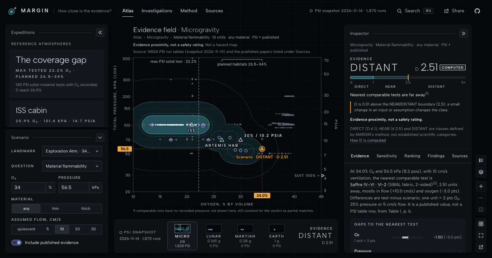

# MARGIN

**How close is the evidence?**

Created and led by **Alex de Gentile**.

MARGIN maps every test run in NASA's Physical Sciences Informatics (PSI) combustion archive against the atmospheres that crewed vehicles and habitats will actually fly. Pick a cabin atmosphere (ISS, an Artemis surface habitat, the 34% O₂ / 8.2 psia Exploration Atmosphere, and others), a fire-safety question and a gravity regime. MARGIN finds the nearest comparable NASA test, reports how far away it is as a documented evidence distance **D**, and shows which investigations are closest and why. Every number links to the PSI table row or the NASA paper it came from.

**Evidence proximity, not a safety rating.** MARGIN measures how close tested conditions come to a scenario. It does not predict fire behaviour, score how dangerous an environment is, certify anything, or claim that two conditions behave the same way.

Built in about 39 hours for [NASA Space Apps 2026](https://www.spaceappschallenge.org/), challenge "Flame in Freefall".

- **Live site:** https://margin-two-rho.vercel.app
- **30-second demo:** _TODO: video URL_
- **Repository:** https://github.com/ADAI-ALEX/margin

<!-- SCREENSHOTS: add 4–6 PNGs from production (see docs/submission/screenshot-shotlist.md) -->


---

## What it shows

- **The coverage gap, computed.** The highest O₂ in any of PSI's 140 solid-material tests with a recorded O₂ value is 22.2%. Artemis surface habitats plan 26.5% and the Exploration Atmosphere 34%; none of those tests reach either level. (Computed at build time from the snapshot; see `HEADLINE` in `lib/data`.)
- **Atlas (`/`).** The O₂ × pressure plane shaded by distance to the nearest comparable test, with PSI runs, published (non-PSI) results, planned experiments and habitat atmospheres as landmarks. A verdict card (DIRECT / NEAR / DISTANT / NONE), a robustness check, and field notes that name the nearest test and the axis that dominates the gap.
- **Four gravity sheets.** Microgravity, lunar, Martian and Earth gravity are separate regimes. No distance is ever computed across them.
- **Partial-gravity panel.** Olson & Ferkul (2012) Table I as points, never lines: for Mylar at 10.2 psia the lunar limiting O₂ (15.6%) is below both the 0 g (17.0%) and 1 g (21.2%) values, so microgravity and Earth results did not bound lunar behaviour for this material.
- **Investigations (`/investigations`).** All 24 PSI combustion investigations plus published groups, ranked for the scenario by a transparent, reweightable score, with a claim ledger, provenance for every value, flow sensitivity, and a compare tray.
- **Dossiers (`/investigations/<id>`).** What varied, what was held constant, the normalised and original run table, and native charts.
- **Method (`/method`) and Sources (`/sources`).** Formulas, scales, thresholds and their rationale, rendered from the engine constants; every reference and licence.
- **Shareable state.** The whole scenario is in the URL (`?preset=ea&o2=34&p=56.5&u=10&g=moon&h=materials&pub=1`).

## The method in brief

Full detail is on the Method page; the constants live in `lib/engine/constants.ts` and the page reads them from there.

1. **Comparability gate.** Before any distance is computed, a run must match the scenario's gravity regime and be relevant to the hazard question (for example, a gas-burner flame is never counted as evidence for cabin fabrics). Planned experiments are never evidence.
2. **Distance.** For each comparable run *r* and scenario *s*:

   ```
   dO2 = (O2_r − O2_s) / 2.0            percentage points
   dP  = ln(P_r / P_s) / ln(1.25)        one unit = a 25% pressure change
   dU  = (U_r − U_s) / 5.0               cm/s (only when both have a numeric flow)
   D   = sqrt(dO2² + dP² + dU²)
   ```

   An axis missing on either side is left out and the match is flagged as partial. Quiescent versus ventilated flow is a regime mismatch, not a number.
3. **Verdict** on the nearest comparable run: **DIRECT** D ≤ 1.0 · **NEAR** D ≤ 2.5 · **DISTANT** D > 2.5 · **NONE** no comparable run in that regime.
4. **Robustness.** The verdict is recomputed with each scale at ½×, 1× and 2× (27 combinations) and reported as Robust or Sensitive.
5. **Gravity rule.** Gravity is categorical. There is no gravity slider, no interpolation and no curve between gravity levels. Every PSI run in the snapshot was flown in microgravity; PSI holds no partial-gravity combustion runs.
6. **Ranking.** `R = 100 × (0.40·Proximity + 0.20·Hazard match + 0.15·Scale + 0.15·Coverage + 0.10·Measurements)`, weights editable.

**What MARGIN is not:** it is not a fire model, not a flammability prediction for any material, not a hazard or risk rating, not a certification aid, and not evidence that a scenario near a test would behave like that test. The scales are expert judgement (rationale and robustness shown), and the tested configurations are narrow.

### Worked example (computed by the engine on the current snapshot)

| Scenario | Evidence | Verdict | D | Nearest comparable test |
|---|---|---|---|---|
| Exploration Atmosphere, 34% O₂ / 56.5 kPa, 10 cm/s, µg, materials | PSI only | DISTANT | 6.28 | Saffire-II, PSI-99 row 2 (partial: no pressure recorded) |
| same | PSI + published | DISTANT (sensitive NEAR–DISTANT) | 2.51 | Saffire VI-2, SIBAL fabric (published, not in PSI) |
| same at 20 cm/s (a different scenario) | PSI + published | NEAR | 1.51 | Saffire VI-2 |
| same, lunar gravity | PSI only | NONE | — | no PSI test in that regime |
| same, lunar gravity | PSI + published | DISTANT | 7.47 | LUCI PMMA rod (published) |

Source of these values: `evaluate()` in `lib/engine` on `data/generated/snapshot.json` (fetched 2026-11-14) and `content/`; reproduced by `tests/e2e/hero-flow.spec.ts`. They change if the data or curated values change; the e2e oracle test fails if the demo narrative no longer holds.

## Data sources and attribution

| Source | What MARGIN uses | Licence / terms |
|---|---|---|
| [NASA Physical Sciences Informatics (PSI)](https://psi.nasa.gov/) | 24 combustion-science investigation records and their experimental tables: **1,870 run rows** (1,828 distinct; the rest are duplicate rows in the source tables) and 130 summary rows (`counts` in `data/generated/snapshot.json`). The ACME CFI-G inverse-flame table has **154 data rows**. | As stated per record by PSI: 23 records state CC0-1.0; PSI-10 (ACME / Flame Design) states no licence. Each investigation is cited by its DOI (10.60555/…). |
| [NASA Technical Reports Server (NTRS)](https://ntrs.nasa.gov/) and peer-reviewed papers | Individual values not in PSI (Saffire IV–VI, BASS-II limit points, Olson & Ferkul 2012 Table I, LUCI, FM2 plans, FLEX limiting O₂), each with document, page or table. | Cited and linked, not redistributed. Full list: [`docs/submission/references.md`](docs/submission/references.md) and the Sources page. |

Data: NASA Physical Sciences Informatics (PSI); NASA Technical Reports Server (NTRS). Use of NASA data does not imply NASA endorsement. This project uses no NASA logos, insignia or mission patches.

**The data licence is separate from the code licence.** The Apache-2.0 licence covers this repository's code only. See [`NOTICE`](NOTICE).

The app makes no calls to NASA at run time. `pipeline/fetch-psi.mjs` downloads the PSI records once; `pipeline/build-data.mjs` normalises them into the versioned snapshot that the site is built from.

## Run it locally

Requires Node.js 20 or later (CI uses Node 24).

```bash
npm ci
npm run dev            # http://localhost:3000

# regenerate the data snapshot from PSI (optional; the snapshot is committed)
npm run data:fetch     # downloads PSI records and tables into pipeline/.cache/
npm run data:build     # writes data/generated/snapshot.json

# checks
npm run typecheck
npm run lint
npm run lint:claims    # banned-claims lint (no safety scores, no gravity interpolation, …)
npm test               # vitest: engine, science and state unit tests
npm run test:e2e       # Playwright against PLAYWRIGHT_BASE_URL (default http://localhost:3000)
npm run build
```

The first Playwright run may need `npx playwright install chromium`. To run the e2e suite against a deployed site: `PLAYWRIGHT_BASE_URL=https://… npx playwright test --project=desktop`.

## Project structure

```
app/                    Next.js App Router routes: / (Atlas), /investigations, /investigations/[id], /method, /sources
components/atlas/       Atlas view: coverage map, gravity sheets, field notes, specimen card
components/casefile/    Investigations view: ladder, claim ledger, provenance, compare tray
components/site/        Global header (carries the scenario across pages) and footer (attribution)
lib/engine/             Pure, deterministic engine: gate, distance, verdict, robustness, ranking
lib/data/               Loads the snapshot and curated content; computed headline numbers
lib/state/              Scenario state and URL encoding (scenarioQuery.ts is unit-tested)
lib/schema/             Canonical types
content/                Curated published (T3) and planned (T4) values with citations
data/generated/         Versioned PSI snapshot (generated by pipeline/)
pipeline/               PSI fetch and normalisation scripts
scripts/                lint-claims.mjs (banned-claims lint) and its reviewed allow-list
tests/unit, tests/science   Vitest
tests/e2e               Playwright (desktop 1440×900 and mobile 390×844 projects)
docs/                   Build log, architecture decision, compliance and submission drafts
```

## Testing

- **Unit and science tests (Vitest):** golden distances (identical → 0; one unit on each axis → 1; √2), verdict thresholds at their boundaries, cross-gravity refusal, real-data anchors, URL-state parsing and clamping of hostile parameters.
- **End-to-end (Playwright, `tests/e2e`):** the 30-second demo path with expectations computed by the engine itself; URL state and hostile parameters; every route returns 200 with no console errors and no horizontal scroll at 390 px; axe-core WCAG 2 A/AA checks; rendered-text rules (no banned claims, gravity is a four-option radiogroup, the partial-gravity plot draws points only).
- **Banned-claims lint (`npm run lint:claims`):** scans `app/`, `components/`, `content/`, `lib/`, this README and the submission drafts for wording that would turn evidence proximity into a hazard judgement, a prediction or a certification, or that implies 0 g and 1 g results bracket partial gravity. The patterns and their rationale are in `scripts/lint-claims.mjs`. Negated disclaimers are allowed; reviewed exceptions live in `scripts/claims-allowlist.json`.
- **CI (`.github/workflows/ci.yml`):** typecheck, ESLint, claims lint, Vitest and `next build` on every push and pull request to `main`, then Playwright (desktop) against `next start`.

## Use of SI (AI)

In line with the NASA Space Apps rules, we disclose that AI (SI) tools assisted the development of MARGIN:

- **Ideation and research:** SI assisted with background research and concept analysis before the event.
- **Build:** AI coding tools wrote much of the source code, the data-pipeline code, the tests and the documentation, and drafted the curated evidence entries, under the direction of the project lead, who set the requirements, chose the design and accepted the work.
- **Review and verification:** SI agents reviewed the code and the method independently, and checked every published value and finding against its primary NASA source (page or table locator plus a short verbatim quote, recorded in `docs/verification/source-verification.md`). These checks are SI-assisted; human sign-off is pending and the app says so. Findings not checked against a primary source stay hidden (currently 1 of 19).
- **No runtime SI.** The deployed app makes no SI calls. All numbers come from the deterministic engine and the cited data.
- **No SI imagery.** No SI-generated images, video or audio are used.

The full tool disclosure for the competition, by phase, is in [`docs/compliance/si-usage-log.md`](docs/compliance/si-usage-log.md).

## Licence

Code: [Apache License 2.0](LICENSE), Copyright 2026 Alex de Gentile.
NASA data, cited publications, fonts and third-party packages keep their own terms; see [`NOTICE`](NOTICE).
