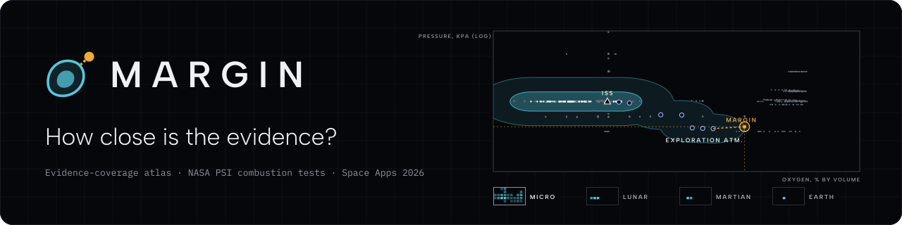
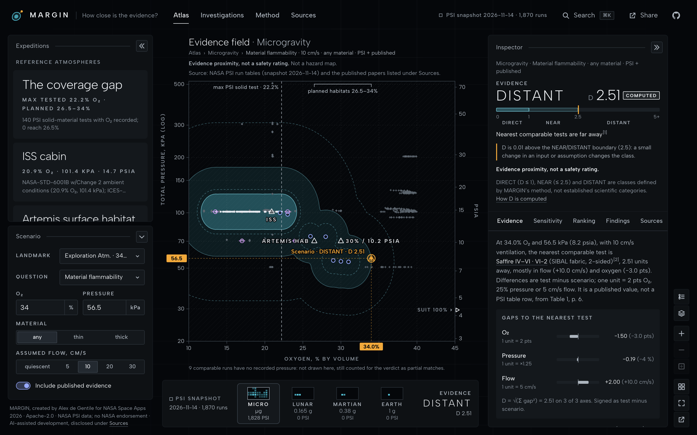
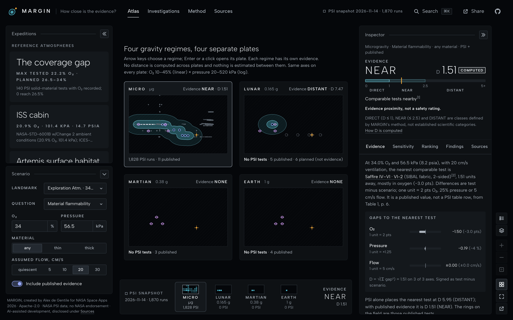
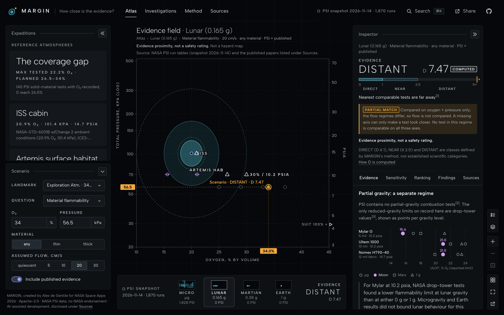
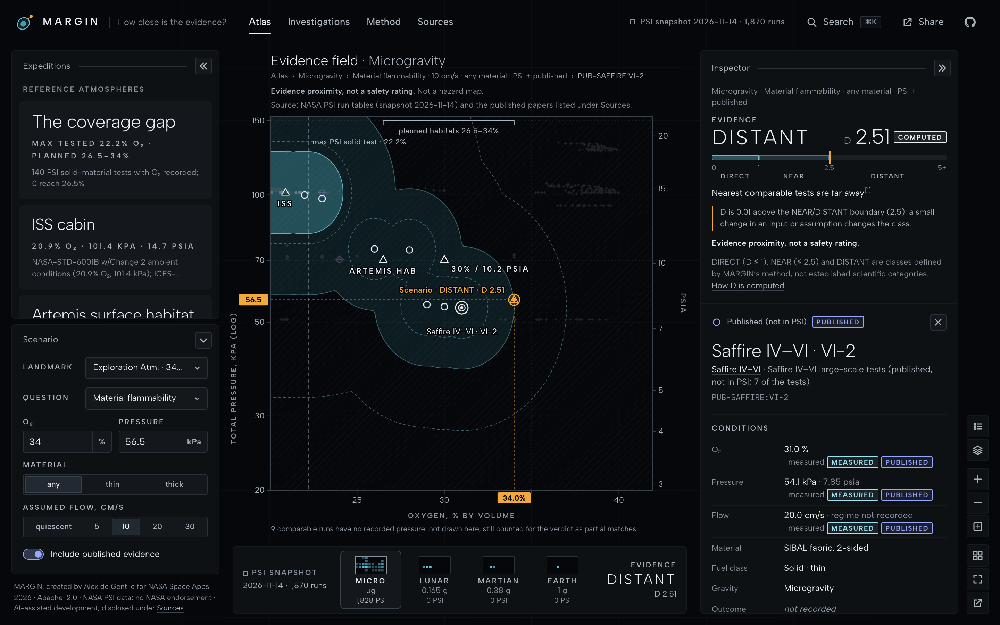
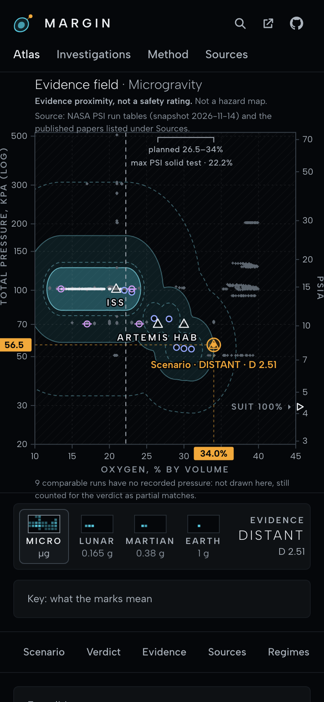
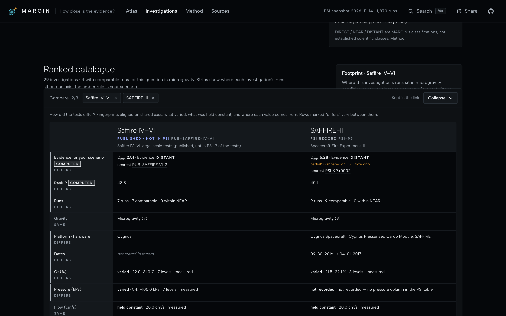
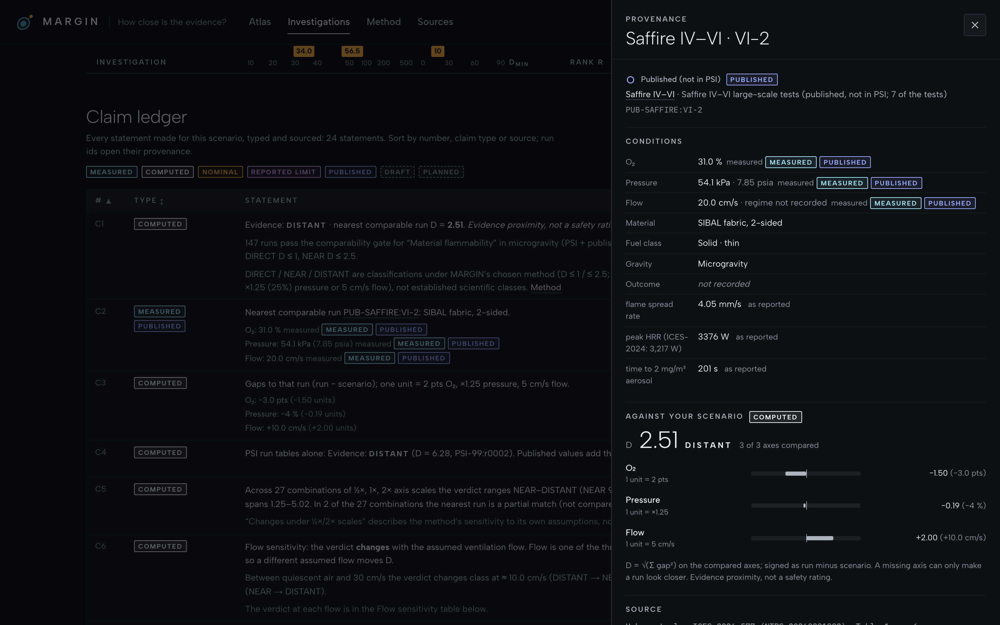
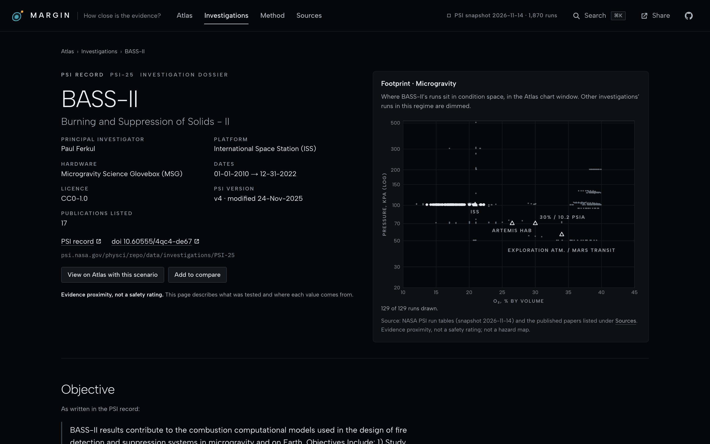
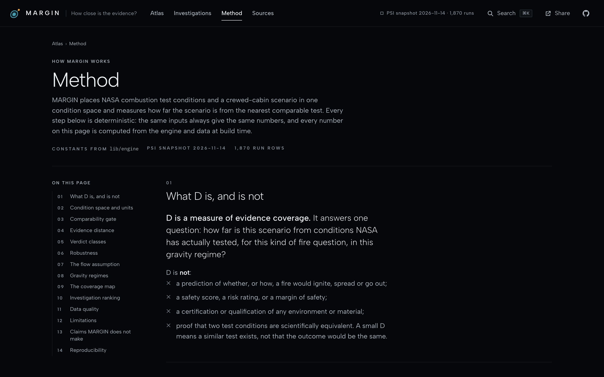

<p align="center"></p>

<p align="center">
  <a href="https://github.com/ADAI-ALEX/margin/actions/workflows/ci.yml"></a>
  
  
  
  
  
  
  <a href="https://margin-two-rho.vercel.app"></a>
  
</p>

**MARGIN** maps every test run in NASA's Physical Sciences Informatics (PSI) combustion archive against the atmospheres that crewed vehicles and habitats will actually fly. Pick a cabin atmosphere, a fire-safety question and a gravity regime, and MARGIN finds the nearest comparable NASA test, reports how far away it is as a documented evidence distance **D**, and links every number to the PSI table row or paper it came from.

Created and led by **Alex de Gentile**. Built for [NASA Space Apps 2026](https://www.spaceappschallenge.org/), challenge "Flame in Freefall".

**Evidence proximity, not a safety rating.** MARGIN measures how close tested conditions come to a scenario. It does not predict fire behaviour, score how dangerous an environment is, certify anything, or claim that two conditions behave the same way.

<p align="center"></p>
<p align="center"><sub>The Atlas: the Exploration Atmosphere (34% O₂, 56.5 kPa) in microgravity with published evidence on. The amber probe sits outside the coverage bands; the nearest comparable test is Saffire VI-2, D 2.51 (DISTANT). The dashed line marks the highest O₂ in any PSI solid-material test.</sub></p>

- **Live site:** https://margin-two-rho.vercel.app
- **30-second demo:** _TODO: video URL_
- **Repository:** https://github.com/ADAI-ALEX/margin

## Contents

[What MARGIN does](#what-margin-does) · [The scientific problem](#the-scientific-problem-the-coverage-gap) · [Features](#features) · [The Atlas](#the-atlas) · [Investigations](#investigations-and-comparison) · [Dossiers](#dossiers-and-run-inspection) · [Methodology](#methodology) · [Data and sources](#nasa-datasets-and-sources) · [Architecture](#architecture) · [Tech stack](#tech-stack) · [Install](#install-and-development) · [Testing](#testing) · [Attribution and licensing](#attribution-ai-use-disclosure-and-licensing)

## What MARGIN does

```text
 1. choose a scenario     a reference cabin atmosphere (or any O₂ / pressure), a fire question, a flow, a gravity regime
 2. gate                  keep only NASA tests relevant to that question, in that gravity regime
 3. measure               the evidence distance D from the scenario to every comparable test
 4. classify              DIRECT (D ≤ 1) · NEAR (D ≤ 2.5) · DISTANT · NONE (no comparable test in that regime)
 5. trace                 every value back to its PSI table row or the page of the NASA paper it came from
```

The whole scenario lives in the URL (`?preset=ea&o2=34&p=56.5&u=10&g=moon&h=materials&pub=1`), so any view can be shared exactly.

## The scientific problem: the coverage gap

Computed at build time from the snapshot (`HEADLINE` in `lib/data`):

> The highest O₂ in any of PSI's **140** solid-material tests with a recorded O₂ value is **22.2%**. Artemis surface habitats plan **26.5%** and the Exploration Atmosphere **34%**; **0** of those tests reach either level.

And every PSI run in the snapshot was flown in microgravity: PSI holds **no** partial-gravity combustion runs. Lunar, Martian and Earth gravity contain only a handful of published or planned points. MARGIN shows that emptiness instead of filling it.

## Features

- **A full-screen evidence field.** The O₂ × pressure plane of one gravity regime fills the screen: coverage bands (D ≤ 1, D ≤ 2.5) in a single cool hue, the ½× / 2× scale envelopes, NASA PSI runs, published results, reported limits, planned experiments and reference cabin atmospheres, with labels placed without collisions.
- **Expeditions.** Curated entry points (the coverage gap, five reference atmospheres, six findings checked against their primary sources), each a complete, shareable state.
- **Four separate gravity regimes.** A four-detent regime selector and a regimes overview of four flat plates. No distance is ever computed across regimes and nothing is drawn between them.
- **A verdict you can audit.** Class word and D, the per-axis gaps, partial-match qualifiers, boundary proximity, 27-combination robustness and flow sensitivity.
- **One run inspector everywhere.** Conditions with units and basis, the distance decomposition to your scenario, flags in plain words, the source row or paper locator with a verbatim quote, and the original cells.
- **Investigations, ranked and compared.** All 24 PSI combustion investigations plus published groups, ranked by a transparent, reweightable score, with footprints, a compare tray and a claim ledger.
- **Command search (⌘K / Ctrl K)** over atmospheres, investigations, findings and runs, entirely on the device.
- **Static, deterministic, auditable.** No backend, no database, no runtime AI. The deployed app makes no calls to NASA.

## The Atlas

The Atlas is a full-screen instrument. The field fills the viewport; Expeditions and the scenario console float on the left, the inspector (verdict first, details in tabs) on the right, the field tools on the right edge, and the regime selector with the snapshot status and verdict readout in an instrument strip at the bottom. When a panel collapses, the field eases into the freed space. Drag or tap to place the probe, or move it with the arrow keys.

<table>
<tr>
<td width="50%"></td>
<td width="50%"></td>
</tr>
<tr>
<td><b>Regimes overview.</b> Four flat plates on shared axes. Only microgravity holds PSI tests.</td>
<td><b>Lunar gravity.</b> No PSI tests; the partial-gravity limits (Olson &amp; Ferkul 2012) are drawn as points, never lines.</td>
</tr>
<tr>
<td></td>
<td></td>
</tr>
<tr>
<td><b>Run inspection.</b> The nearest test, its gaps to the scenario and its source.</td>
<td><b>Mobile.</b> The field first; tap to place the probe.</td>
</tr>
</table>

## Investigations and comparison

`/investigations` ranks every investigation for the current scenario, shows where each one's runs sit on each axis and in condition space, and lets you pin up to three into a compare tray (kept in the link as `cmp=`). The claim ledger lists every statement made for the scenario, typed (MEASURED, COMPUTED, NOMINAL, REPORTED LIMIT, PUBLISHED, DRAFT, PLANNED), and each run id opens its provenance.

<table>
<tr>
<td width="50%"></td>
<td width="50%"></td>
</tr>
<tr>
<td><b>Ranked catalogue and compare tray.</b></td>
<td><b>Claim ledger and provenance.</b></td>
</tr>
</table>

## Dossiers and run inspection

Each investigation has a statically generated dossier (`/investigations/<id>`): its footprint in condition space, PI, platform, dates, PSI and DOI links, a computed fingerprint (what varied, what was held constant, what was never recorded), native charts and the normalised and original run table. Investigations with summary rows only say so.

<table>
<tr>
<td width="50%"></td>
<td width="50%"></td>
</tr>
<tr>
<td><b>Dossier.</b> BASS-II (PSI-25).</td>
<td><b>Method.</b> Every constant rendered from the engine.</td>
</tr>
</table>

## Methodology

Full detail is on the [Method page](https://margin-two-rho.vercel.app/method); the constants live in `lib/engine/constants.ts` and the page reads them from there.

1. **Comparability gate.** A run must match the scenario's gravity regime and be relevant to the hazard question (a gas-burner flame is never evidence for cabin fabrics). Planned experiments are never evidence; reported limits are shown but never set the verdict.
2. **Distance.** For each comparable run *r* and scenario *s*:

   ```
   dO2 = (O2_r − O2_s) / 2.0            percentage points
   dP  = ln(P_r / P_s) / ln(1.25)        one unit = a 25% pressure change
   dU  = (U_r − U_s) / 5.0               cm/s (only when both have a numeric flow)
   D   = sqrt(dO2² + dP² + dU²)
   ```

   An axis missing on either side is left out and the match is flagged as partial. Quiescent versus ventilated flow is a regime mismatch, not a number.
3. **Verdict** on the nearest comparable run: **DIRECT** D ≤ 1.0 · **NEAR** D ≤ 2.5 · **DISTANT** D > 2.5 · **NONE** no comparable run in that regime.
4. **Robustness.** The verdict is recomputed with each scale at ½×, 1× and 2× (27 combinations) and reported as Robust or Sensitive.
5. **Gravity rule.** Gravity is categorical: no gravity slider, no interpolation and no curve between gravity levels.
6. **Ranking.** `R = 100 × (0.40·Proximity + 0.20·Hazard match + 0.15·Scale + 0.15·Coverage + 0.10·Measurements)`, weights editable.

**What MARGIN is not:** it is not a fire model, not a flammability prediction for any material, not a hazard or risk rating, not a certification aid, and not evidence that a scenario near a test would behave like that test. The scales are expert judgement (rationale and robustness shown), and the tested configurations are narrow.

### Worked example (computed by the engine on the current snapshot)

| Scenario | Evidence | Verdict | D | Nearest comparable test |
|---|---|---|---|---|
| Exploration Atmosphere, 34% O₂ / 56.5 kPa, 10 cm/s, µg, materials | PSI only | DISTANT | 6.28 | Saffire-II, PSI-99 row 2 (partial: no pressure recorded) |
| same | PSI + published | DISTANT (sensitive NEAR–DISTANT) | 2.51 | Saffire VI-2, SIBAL fabric (published, not in PSI) |
| same at 20 cm/s (a different scenario) | PSI + published | NEAR | 1.51 | Saffire VI-2 |
| same, lunar gravity | PSI only | NONE | — | no PSI test in that regime |
| same, lunar gravity | PSI + published | DISTANT | 7.47 | LUCI PMMA rod (published; partial: the flow regimes differ) |

Source of these values: `evaluate()` in `lib/engine` on `data/generated/snapshot.json` (fetched 2026-11-14) and `content/`; re-checked for this README and reproduced by `tests/e2e/hero-flow.spec.ts`, whose oracle test fails if the demo narrative no longer holds.

## NASA datasets and sources

| Source | What MARGIN uses | Licence / terms |
|---|---|---|
| [NASA Physical Sciences Informatics (PSI)](https://psi.nasa.gov/) | 24 combustion-science investigation records and their experimental tables: **1,870 run rows** (1,828 distinct; the rest are duplicate rows in the source tables) and 130 summary rows (`counts` in `data/generated/snapshot.json`). 887 runs record ambient O₂; 857 record both O₂ and pressure and can be placed on the field. | As stated per record by PSI: 23 records state CC0-1.0; PSI-10 (ACME / Flame Design) states no licence. Each investigation is cited by its DOI (10.60555/…). |
| [NASA Technical Reports Server (NTRS)](https://ntrs.nasa.gov/) and peer-reviewed papers | Individual values not in PSI (Saffire IV–VI, BASS-II limit points, Olson & Ferkul 2012 Table I, LUCI, FM2 plans, FLEX limiting O₂), each with document, page or table. | Cited and linked, not redistributed. Full list: [`docs/submission/references.md`](docs/submission/references.md) and the Sources page. |

Data: NASA Physical Sciences Informatics (PSI); NASA Technical Reports Server (NTRS). Use of NASA data does not imply NASA endorsement. This project uses no NASA logos, insignia or mission patches.

**The data licence is separate from the code licence.** The Apache-2.0 licence covers this repository's code only. See [`NOTICE`](NOTICE).

## Architecture

```text
pipeline/          fetch-psi.mjs → build-data.mjs        (run once; not at request time)
data/generated/    snapshot.json                         (versioned PSI snapshot)
content/           curated published and planned values with citations and verification status
lib/engine/        gate · distance · verdict · robustness · ranking · field · sensitivity   (pure, deterministic)
lib/data/          snapshot + curated content, computed headline numbers
lib/state/         scenario ⇄ URL (scenarioQuery.ts), view-only params (viewQuery.ts), useMargin
lib/view/          presentation view-models: expeditions, regimes, label placement, search index
components/        atlas · casefile (investigations) · dossier · docs · run (run inspector) · ui (shared) · site
app/               routes, all statically prerendered
```

Every route is prerendered as static HTML. The Atlas and Investigations pages hydrate and run the engine in the browser (about 2,000 runs, a few milliseconds per evaluation); Method and Sources compute their numbers at build time from the same engine and data. **No backend, no database, no runtime AI**: the data is static and versioned, and the deployed app makes no calls to NASA. Details: [`docs/ARCHITECTURE.md`](docs/ARCHITECTURE.md). Design system and research: [`docs/design/`](docs/design/).

## Tech stack

Next.js 16 (App Router, Turbopack, Cache Components) · React 19 · TypeScript (strict) · bespoke SVG charts on `d3-scale`, `d3-contour`, `d3-shape`, `d3-array` · `zod` · Albert Sans and IBM Plex Mono (SIL OFL 1.1, self-hosted via `next/font`) · Vitest · Playwright with axe-core · Vercel.

## Install and development

Requires Node.js 20 or later (CI uses Node 24).

```bash
npm ci
npm run dev            # http://localhost:3000

# regenerate the data snapshot from PSI (optional; the snapshot is committed)
npm run data:fetch     # downloads PSI records and tables into pipeline/.cache/
npm run data:build     # writes data/generated/snapshot.json

# checks
npm run typecheck
npm run lint
npm run lint:claims    # banned-claims lint (no safety scores, no gravity interpolation, …)
npm test               # vitest: engine, science, state and view unit tests
npm run test:e2e       # Playwright against PLAYWRIGHT_BASE_URL (default http://localhost:3000)
npm run build
```

The first Playwright run may need `npx playwright install chromium`. To run the e2e suite against a deployed site: `PLAYWRIGHT_BASE_URL=https://… npx playwright test --project=desktop`. README screenshots: `node scripts/capture-readme.mjs <baseUrl>`.

## Testing

- **Unit and science tests (Vitest):** golden distances (identical → 0; one unit on each axis → 1; √2), verdict thresholds at their boundaries, cross-gravity refusal, real-data anchors, URL-state parsing and clamping of hostile parameters, view-only URL params, and collision-free label placement.
- **End-to-end (Playwright, `tests/e2e`, desktop 1440×900 and mobile 390×844):** the 30-second demo path with expectations computed by the engine itself; URL state and hostile parameters; run inspection, the regimes overview, view params, Esc and focus return, expeditions and command search; every route returns 200 with no console errors and no horizontal scroll at 390 px; axe-core WCAG 2 A/AA checks; rendered-text rules (no banned claims, gravity is a four-option radiogroup, the partial-gravity plot draws points only, no NASA insignia).
- **Banned-claims lint (`npm run lint:claims`):** scans `app/`, `components/`, `content/`, `lib/`, this README and the submission drafts for wording that would turn evidence proximity into a hazard judgement, a prediction or a certification. Negated disclaimers are allowed; reviewed exceptions live in `scripts/claims-allowlist.json`.
- **CI (`.github/workflows/ci.yml`):** typecheck, ESLint, claims lint, Vitest and `next build` on every push and pull request to `main`, then Playwright (desktop) against `next start`.

Last full local run, 2026-11-14, against a production build: Vitest **202 passed**; Playwright **221 passed, 1 skipped** (desktop and mobile; the skipped test checks the desktop tool rail and does not apply on phones).

## Attribution, AI-use disclosure and licensing

Created and led by **Alex de Gentile** for NASA Space Apps 2026.

### Use of SI (AI)

In line with the NASA Space Apps rules, we disclose that AI (SI) tools assisted the development of MARGIN:

- **Ideation and research:** SI assisted with background research and concept analysis before the event.
- **Build:** AI coding tools wrote much of the source code, the data-pipeline code, the tests and the documentation, and drafted the curated evidence entries, under the direction of the project lead, who set the requirements, chose the design and accepted the work.
- **Review and verification:** SI agents reviewed the code and the method independently, and checked every published value and finding against its primary NASA source (page or table locator plus a short verbatim quote, recorded in `docs/verification/source-verification.md`). These checks are SI-assisted; human sign-off is pending and the app says so. Findings not checked against a primary source stay hidden (currently 1 of 19).
- **No runtime SI.** The deployed app makes no SI calls. All numbers come from the deterministic engine and the cited data.
- **No SI imagery.** No SI-generated images, video or audio are used.

The full tool disclosure for the competition, by phase, is in [`docs/compliance/si-usage-log.md`](docs/compliance/si-usage-log.md).

### Licence

Code: [Apache License 2.0](LICENSE), Copyright 2026 Alex de Gentile.
NASA data, cited publications, fonts and third-party packages keep their own terms; see [`NOTICE`](NOTICE).
